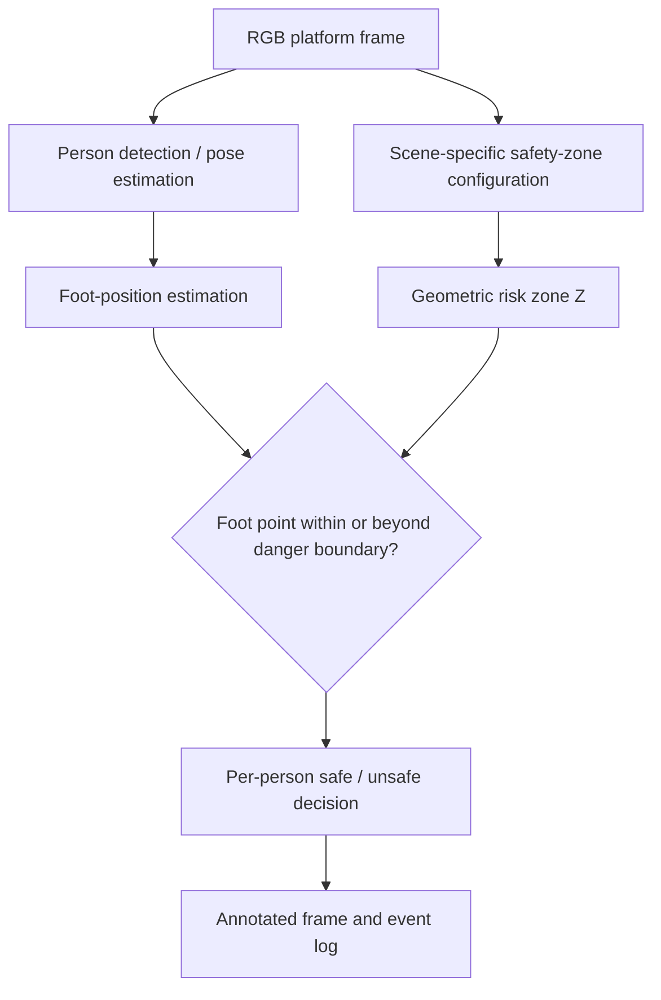

# RailGuard

**Vision-based railway platform safety monitoring**

RailGuard is a course project for **CS406 – Image Processing and Applications**. The project studies how RGB images can be used to identify passengers entering a hazardous area near the platform edge.

> **Status:** Project setup and research design. The implementation, trained weights, experimental results, and demo are **not available yet**. This README describes the intended, testable pipeline; it does not claim completed experiments.

## 1. Problem statement

Railway platforms are crowded, visually complex environments where people may stand or move beyond a designated safety line. The goal is to detect **whether an individual crosses the safety boundary** in a camera view, rather than only detecting the presence of people.

| Component | Definition |
| --- | --- |
| **Input** | RGB image or frame from a railway-platform camera |
| **Processing** | Person detection / pose estimation, scene-specific safety-zone geometry, and spatial rule |
| **Output** | Per-person safe / unsafe decision, confidence and visual explanation |
| **Evaluation** | Instance-level precision, recall, F1-score, confusion matrix; frame-level alert performance and inference speed where applicable |

The research focus is the **position of a person relative to the platform's safety line and edge**. The system is a research prototype, **not a certified railway-safety system**.

## 2. Planned approach



We plan to compare two spatial decision methods under the **same evaluation protocol**:

| Method | Foot-position estimate | Purpose |
| --- | --- | --- |
| **Baseline: bounding box** | Bottom-center of the person's bounding box | Lightweight reference method |
| **Pose-based method** | Estimated ankle / foot keypoints, with explicit handling of missing or low-confidence points | Study whether pose cues improve boundary decisions |

We plan to use **YOLO-based person detection and pose estimation** with **OpenCV/NumPy geometry**. The exact models, checkpoints, confidence thresholds, and post-processing rules will be documented with the corresponding implementation.

**Zone geometry:** Let `L` denote the safety line, `E` the platform edge, and `Z` the defined hazardous region. For the initial version, `Z` will be configured **per camera/scene** rather than assumed to be supplied by the dataset. This matters because the published labels do **not** provide ready-to-use safety-line polygon coordinates.

## 3. Dataset: RailEye3D

This project uses the [RailEye3D dataset annotations](https://github.com/raileye3d/raileye3d_dataset), associated with *RGB-D Railway Platform Monitoring and Scene Understanding for Enhanced Passenger Safety* (ICPR Workshops, 2021).

- The original dataset contains **10 image sequences from 6 railway stations in Austria**.
- The **initial study focuses on Stockerau (`red-00`) and Fels (`red-04`)**, subject to access to their image sequences.
- Published per-frame bounding-box CSV rows have the form `TLx, TLy, BRx, BRy, labelName, objectId`.
- Corresponding parameter CSV rows provide `degree_of_occlusion, beyond_safety_line` **in the matching instance order**.
- The `beyond_safety_line` attribute is the primary supervision/evaluation target. It must not be mistaken for a geometric coordinate or an annotated line.
- The annotations are public, but **image sequences must be requested from the dataset authors**; the official README provides the contact instructions.

Dataset source: https://github.com/raileye3d/raileye3d_dataset

Dataset use is governed by the **original authors' non-commercial licence**. Do not redistribute image files without permission. No original RailEye3D images or large model checkpoints are stored in this repository.

### Leakage-aware split

We will split by **entire sequence/video** rather than randomly splitting frames of the same recording. Where feasible, we will additionally evaluate a **cross-station generalization** scenario. Training, validation and test sets, sequence IDs, class balance and sampling policy will be published before reporting final results.

## 4. Planned experiments

1. **Detection / pose processing:** inspect localization quality and failure cases.
2. **Baseline vs. pose:** compare bounding-box foot points with keypoint-based foot points using consistent safety zones.
3. **Ablation:** evaluate confidence thresholds, occlusion handling, and foot-point fallback rules.
4. **Failure analysis:** review occlusion, perspective, inaccurate detections, persons near the boundary and camera/scene changes.
5. **Demo:** upload an image or video, visualize persons and the configured zone, and display any predicted violations.

Key metrics will include **precision, recall, F1-score and confusion matrix** for the unsafe class. Accuracy alone can be misleading when violations are rare. For alert-style evaluation, we will also report frame/event-level results when reliable temporal labels and appropriate code are available.

No numerical scores are reported before the actual experiments are run.

## 5. Repository organization

The **intended** structure is shown below. Directories and commands will be added as they are implemented.

```text
RailGuard/
├── configs/             # camera zones, models and experiment settings
├── src/railguard/        # annotation parsing, detection, pose and geometry
├── scripts/              # data preparation, training (if needed), evaluation
├── app/                  # visual demonstration
├── tests/                # parser, geometry and integration tests
├── docs/                 # methodology and experiment protocol
├── requirements.txt      # Python dependencies (to be added)
└── README.md
```

### Installation

**Pending implementation.** The repository does not yet contain executable installation instructions. The release README will specify a Python version, dependencies, model-download procedure and reproducible commands.

### Data preparation

**Pending implementation.** Image sequences are obtained separately from the dataset authors. Annotation parsing will match boxes and parameters **by sequence, frame and row order**, with validation checks for missing/misaligned records.

### Training

**Pending implementation.** Pretrained YOLO models may be used; fine-tuning will only be included if supported by data, compute and an explicit experimental need. Pretrained-model sources and licences will be credited.

### Testing and evaluation

**Pending implementation.** We will provide a reproducible evaluation script, split manifest, per-class metrics, comparison table and failure-case examples.

### Demo

**Pending implementation.** The planned demo will use the actual model/rules, not a mockup.

## 6. Responsible use and limitations

Results are expected to depend on camera calibration, perspective, lighting, occlusion and scene-specific zone configuration. The output must be interpreted as an **experimental warning**, not a decision to control train operations or replace platform staff. Dataset restrictions, attribution and individual privacy must be respected.

## 7. References

**Dataset and paper**

Wallner, M., Steininger, D., Widhalm, V., Schoerghuber, M., & Beleznai, C. (2021). *RGB-D Railway Platform Monitoring and Scene Understanding for Enhanced Passenger Safety.* Pattern Recognition: ICPR International Workshops and Challenges. Springer.

- Dataset and annotations: https://github.com/raileye3d/raileye3d_dataset
- Paper DOI: https://doi.org/10.1007/978-3-030-68787-8_47
- Ultralytics documentation (potential model provider): https://docs.ultralytics.com/

---

**Course:** CS406 – Image Processing and Applications  
**Project:** RailGuard  
**Scope:** Research and educational use only
