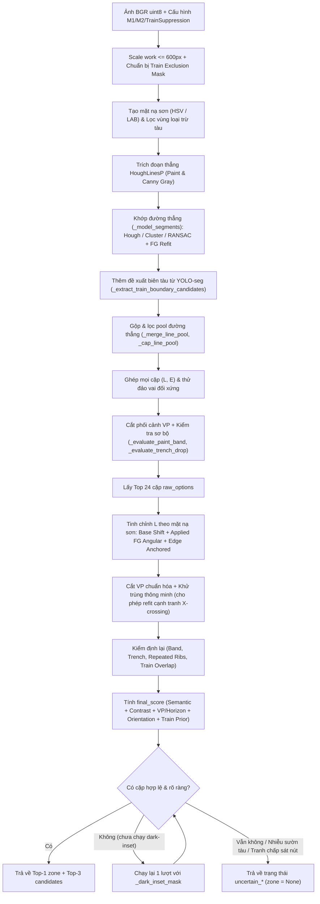

# Chi tiết Pipeline Xác định Vạch An Toàn (`L`) & Mép Sân Ga (`E`) — Module M2

Tài liệu này mô tả chính xác toàn bộ quy trình, thuật toán và tham số hiện hành dùng để xác định **vạch sơn an toàn `L`**, **mép sân ga `E`** và **vùng nguy hiểm `Z`** trong codebase RailGuard.

Các tệp nguồn chính:
- [railguard/boundaries.py](../railguard/boundaries.py): toàn bộ thuật toán trích đặc trưng, dựng đường thẳng, khử nhiễu tàu, ghép cặp, tinh chỉnh vạch sơn và chấm điểm (`estimate_zone`).
- [railguard/line_models.py](../railguard/line_models.py): khớp đường thẳng SVD có trọng số (`fit_line`), 2-point RANSAC (`fit_line_ransac`), gom cụm đoạn thẳng (`line_clustering`).
- [railguard/train_mask.py](../railguard/train_mask.py): bộ tạo mặt nạ thân tàu bằng YOLO11-seg (`YoloSegTrainMaskProvider`).
- [railguard/geometry.py](../railguard/geometry.py): hình học `Segment`, `HazardZone`, khoảng cách có dấu độc lập góc xoay và cắt đa giác hành lang phối cảnh.
- [railguard/server.py](../railguard/server.py) & [railguard/preprocessing.py](../railguard/preprocessing.py): luồng gọi từ Web Studio (`/api/auto-zone`) và tiền xử lý M1.

---

## 1. Cấu hình đầu vào, phương pháp & đầu ra

### 1.1. Các phương pháp phát hiện vạch (`M2_METHODS`)
Hàm trung tâm là `estimate_zone(...)` trong `railguard/boundaries.py`, hỗ trợ 7 phương pháp chính (cùng 4 alias cũ trong `_LEGACY_METHODS`):

| Tên chính thức | Không gian màu trích vạch | Thuật toán fit đoạn thẳng | Ghi chú |
|---|---|---|---|
| `hsv_canny_hough` | HSV | `hough` (sắp theo độ dài + ưu tiên dốc đứng) | Alias cũ: `color_hough` |
| `lab_canny_hough` | LAB | `hough` | Dựa vào kênh L & b |
| `hsv_hough_cluster` | HSV | `cluster` (`line_clustering` + SVD có trọng số) | Alias cũ: `canny_hough` |
| `lab_hough_cluster` | LAB | `cluster` | |
| `hsv_hough_ransac` | HSV | `ransac` (`fit_line_ransac` + multi-pass peel) | Alias cũ: `color_ransac` |
| `lab_hough_ransac` | LAB | `ransac` | |
| `hybrid_region_evidence` | **HSV + LAB hợp nhất** | **RANSAC + Hough gộp chung** | Alias cũ: `hybrid` (mặc định trên Studio) |

Cạnh cấu trúc nền (ứng viên cho mép sân ga `E`) luôn được trích trên ảnh xám bằng `Canny(GaussianBlur(5x5), 65, 145)` + `HoughLinesP`.

### 1.2. Các tùy chọn chính
- **Tiền xử lý M1 (`preprocess`)**: `"raw"`, `"clahe"`, `"gamma"` (gamma LUT = `1.4` trong `_preprocess_m1`).
  - *Lưu ý luồng Web Studio (`/api/auto-zone`)*: trong `railguard/server.py`, các chế độ thuộc `_M3_GLARE_ONLY_PREPROCS` (`"auto"`, `"highlight_compress"`, `"glare_suppress"`, `"exposure_fusion"`, `"mertens_fusion"`, `"gamma"`, `"clahe"`) được chạy ở ảnh **`raw`** cho riêng M2 để tránh làm méo phân ngưỡng màu vạch sơn; tiền xử lý chống lóa chỉ áp dụng cho nhánh phát hiện người M3.
- **Quy ước vạch (`stripe_convention`)**:
  - `"safe_side_edge"` (mặc định): dịch `L` ra **mép ngoài về phía sân ga an toàn** (phía đối diện với `E`).
  - `"stripe_center"`: dịch `L` vào **tâm dải vạch sơn**.
- **Khử nhiễu tàu (`train_suppression`)**: `"off"`, `"structural"` (mặc định), `"yolo_seg"`, `"hybrid_yolo_seg"`.
- **Chuẩn hóa độ phân giải làm việc**:
  - Nếu cạnh nhỏ ảnh gốc `min(H, W) > 720`, ảnh được scale về `min_dim = 600 px` bằng `cv2.INTER_AREA` (RANSAC hạ xuống tối đa `90` trials thay vì `240`) để tăng tốc, sau đó tọa độ kết quả được scale ngược về kích thước gốc qua `_rescale_segment`.

### 1.3. Trạng thái trả về (`LineResult`)
`estimate_zone` trả về `LineResult(zone, status, diagnostics, candidates)`:
- `estimated_review_required`: tìm được cặp `(L, E)` đạt chuẩn (vẫn gắn cờ nhắc người dùng kiểm tra lại do bản chất heuristic RGB).
- `uncertain_image_too_small`: ảnh `< 32x32`.
- `uncertain_no_paint_line`: không tìm thấy đường sơn nào (kể cả sau fallback dark-inset).
- `uncertain_ambiguous_orientation`: không phân biệt rõ vai trò `L` và `E` (đảo ngược điểm ngang nhau).
- `uncertain_no_platform_edge`: không cặp nào vượt qua kiểm định mép sân ga (hoặc toàn cảnh bị nhiễu sườn nóc tàu).
- `uncertain_competing_geometry`: Top-1 và Top-2 khác biệt rõ rệt về hình học (`mean_normalized_separation >= 0.06` hoặc đổi phía) nhưng chênh lệch điểm quá sít sao (`score_margin < max(8.0, 0.02 * |score|)`).

---

## 2. Sơ đồ tổng thể luồng xử lý

---

## 3. Pha 1: Phân tách mặt nạ sơn & trích đoạn thẳng

### 3.1. Mặt nạ sơn vàng và trắng (`_paint_masks`)
Hàm tạo 2 mặt nạ tách biệt `(yellow, white)` để 1 dải sơn không thể đồng thời đóng 2 vai trò (`white = white & ~yellow`):

- **Không gian HSV (`color_space="hsv"`)**:
  - **Vàng**: `H in [14, 30]`, `S in [45, 255]`, `V in [75, 255]`. Giới hạn `H <= 30` giúp loại trừ thân tàu màu xanh chuối (`H >= 31`).
  - **Chống ngập nền gạch/đá màu ấm**: nếu tỷ lệ pixel vàng `> 23%` diện tích ảnh, đặt ngưỡng thích nghi `v_thr = max(165, p75(V_yellow))` và chỉ giữ các pixel thỏa `((S >= 135) & (V >= 135)) | ((V >= v_thr) & (S >= 50))`.
  - **Trắng**: ngưỡng độ sáng thích nghi `adaptive_white = clip(max(185, min(238, p90(V) + 0.20 * (V_max - p90))), 0, 255)` với `S <= 65`.
- **Không gian LAB (`color_space="lab"`)**:
  - **Trắng**: `L >= adaptive_white` (tính theo `L`), `a in [110, 146]`, `b in [110, 146]`.
  - **Vàng**: `L >= 75`, `a in [115, 155]`, `b in [140, 235]`.
  - **Chống ngập nền đá be/vàng nhạt**: nếu diện tích vàng `> 23%`, chỉ giữ `(b >= 152) | ((L >= max(145, p75(L_yellow))) & (b >= 143))`.
- **Làm sạch hình thái học**: áp dụng `MORPH_OPEN` kernel `3x3` (xóa đốm nhiễu nhỏ) rồi `MORPH_CLOSE` kernel `5x5` (lấp lỗ hổng nhỏ trên vạch).

### 3.2. Mặt nạ vạch tối lún (`_dark_inset_mask`, dùng khi fallback)
Dành cho sân ga có vạch ranh giới tối màu lọt giữa hai dải lát sáng hơn (ví dụ bị lóa mạnh khiến vạch sơn mất màu):
- Tính độ sáng trung bình ngang `mean_x = blur(L, (k, 5))` dịch sang trái/phải khoảng `off = max(12, round(0.045 * d))` với `d = min(H, W)`.
- Pixel thuộc dark-inset khi thung lũng sáng `min(left_m, right_m) - center >= 8.0` và sắc độ `chroma = hypot(a - 128, b - 128) <= 34.0`.

### 3.3. Trích đoạn thẳng ứng viên (`_candidate_segments`)
- Biên cạnh được rút ra bằng `cv2.Canny(..., 35, 110)` cho mặt nạ sơn hoặc `cv2.Canny(GaussianBlur(gray, 5x5), 65, 145)` cho nền cấu trúc.
- Nếu có mặt nạ tàu `exclude_mask` (`train_core`), mặt nạ được co vào trong thêm `margin_k = max(5, round(0.014 * min(H, W)) | 1)` trước khi xóa biên (`edges[interior_exclude] = 0`) để không vô tình xóa mất pixel mép sân ga nằm ngay sát vỏ tàu.
- Chạy `cv2.HoughLinesP`:
  - `rho = 1`, `theta = pi / 180`
  - `threshold = max(16, min(H, W) // 16)`
  - `minLineLength = max(20, round(0.10 * min(H, W)))`
  - `maxLineGap = max(10, round(0.06 * min(H, W)))`
- Khử đoạn ngang trên trần/nóc nhà (`max(y0, y1) < 0.22 * min(H, W)` và `|dy| < 0.35 * |dx|`) và loại đoạn ngắn `< max(20, 0.09 * min(H, W))`.

---

## 4. Pha 2: Khớp đường thẳng & gom cụm (`_model_segments`)

Mỗi nhóm đoạn thẳng được chuyển thành đường thẳng vô hạn kéo dài tới biên ảnh (`_extend_to_image`) theo 3 cơ chế:

1. **`hough`**:
   - Sắp xếp từng đoạn giảm dần theo độ dài, ưu tiên nhóm **dốc đứng chạm nửa dưới ảnh** (`|dy| >= 0.85 * |dx|` và `max_y >= 0.45 * H`).
   - Fit trực tiếp đường thẳng qua 2 đầu mút từng đoạn (`max_lines = 44`, hoặc `26` khi downscale).
2. **`cluster`**:
   - Dùng `line_clustering` trong `railguard/line_models.py` (Union-Find): gom hai đoạn nếu góc lệch `<= 4.5°`, khoảng cách vuông góc từ hai tâm đoạn `<= max(4.0, 0.30 * distance_px)` (trong đó `distance_px = max(4.0, 0.022 * min(H, W))`), và khe hở dọc giữa hai đoạn `<= max(distance_threshold * 10, 160 px)`.
   - Lấy mẫu 5 điểm mỗi đoạn (`alpha = 0, 0.25, 0.5, 0.75, 1.0`) với **trọng số ưu tiên điểm gần camera**:
     $$w(y) = 1.0 + 2.5 \cdot y_{\text{norm}}^{1.5}$$
   - Khớp bằng SVD có trọng số (`fit_line`). Nếu cụm lớn (`>= 8` đoạn) có trung vị sai số lớn (`> max(3.5, 0.30 * distance_px)`), giữ thêm đường dài nhất làm ứng viên phụ (`_maybe_append_top_member`).
3. **`ransac`** (và trong `hybrid_region_evidence`):
   - Khớp 2-point RANSAC (`fit_line_ransac`) với ngưỡng phần dư `thresh = max(1.5, 0.50 * distance_px)`, `min_inlier_ratio = 0.45` (có fallback nới `thresh * 1.35` & ratio `0.25` nếu không hội tụ), sau đó refit lại bằng `fit_line` có trọng số trên tập inlier.
   - **Multi-pass RANSAC peel**: nếu cụm có `>= 8` đoạn, tiếp tục bóc phần tử ngoại lai tối đa `2` lượt (khi còn `>= max(12, 0.22 * N)` điểm) để không làm mất mép sân ga nằm song song ngay cạnh đường khác.
4. **Foreground Refit (`_maybe_append_foreground_refit`)**:
   - Sinh thêm tối đa 8 đường phụ chỉ bám vào vùng **Mid `[0.45H, 0.70H)`** và **Near `[0.70H, 0.96H]`** (yêu cầu mỗi vùng tối thiểu 3 điểm và tổng chiều cao `>= 0.18H`), trọng số `1.0 + 3.0 * y_norm^1.5`, lọc inlier 1 lần và chỉ giữ nếu lệch góc `<= 6.5°` so với đường gốc.
5. **Gộp & cắt pool đường thẳng**:
   - `_merge_line_pool`: khử trùng các đường lệch góc `< cos^-1(0.9975) (~ 4.05°)` và khoảng cách pháp tuyến `<= dup_tol = max(4.0, 0.38 * distance_px)`, ưu tiên giữ `ransac` hoặc đường sơn dài hơn; không bao giờ gộp `train_boundary` với đường thường.
   - `_cap_line_pool` (khi downscale): giữ tối đa 18 đường `paint` và 20 đường `edge`, nhân hệ số ưu tiên `2.2x` cho đường dốc xuống vùng đáy (`max_y >= 0.72H`).

---

## 5. Pha 3: Khử nhiễu tàu (`train_suppression`)

### 5.1. Mặt nạ YOLO-seg (`yolo_seg` & `hybrid_yolo_seg`)
- `YoloSegTrainMaskProvider` (`railguard/train_mask.py`) chạy model `yolo11n-seg.pt` với `classes=[6]` (COCO class `train`), `conf=0.25`, `imgsz=640`, `retina_masks=True`.
- Bỏ các thành phần liên thông nhỏ `< ceil(0.002 * H * W)`.
- `_prepare_train_exclusion` co mặt nạ bằng ellipse bán kính `k = max(5, round(0.015 * min(H, W)))` tạo lõi `core` và biên `boundary`. Mặt nạ chỉ hợp lệ khi độ phủ nằm trong `[0.005, 0.85]` và `core` khác rỗng.

### 5.2. Đề xuất biên tàu làm ứng viên `E` (`_extract_train_boundary_candidates`)
Khi mặt nạ YOLO-seg hợp lệ:
1. Kiểm tra tàu bám chắc mép trái hay mép phải khung ảnh ở vùng `y in [0.35H, 0.96H]` (chạm mép `>= 40%` số dòng ở một bên và `<= 15%` ở bên còn lại).
2. Lấy ranh giới ngoài cùng của thân tàu hướng về phía sân ga trên từng dòng `y in [0.38H, 0.96H)`, loại điểm nhảy vọt median, chạy RANSAC + `fit_line` trọng số gần camera để được **`sil_line`** (`can_be_L=False, can_be_E=True`).
3. **Platformward Snap**: quanh `sil_line`, quét lân cận `[-0.008d, +0.032d]` về phía sân ga để tìm vị trí vừa có hố tối (nền sân ga sáng hơn mép gầm/khe tàu) vừa có gradient ngang mạnh nhất (`sc = (plat_mean - pit_val) + 0.55 * grad_h >= 14.0`). Fit RANSAC + `fit_line` nếu lệch góc `<= 6°` và dịch `>= 2 px` tạo ra **`snap_line`**.

### 5.3. Phát hiện sườn nóc tàu tuần hoàn (`_evaluate_repeated_ribs`)
Dùng ở chế độ `structural` (và mọi chế độ trừ `off`) để tránh nhận nhầm các gân/sườn nóc tàu lặp chu kỳ (như ca `moscow_4`):
- Lấy tín hiệu độ sáng `L` theo phương vuông góc hai bên ứng viên (`safe_r` và `far_r`, bán kính `0.22 * d`) tại tối đa 23 trạm.
- Tìm các rãnh tối (`_trough_features` với độ sâu chuẩn hóa `prominence >= 0.18` và chênh raw `>= 18`), tính chu kỳ tuần hoàn bằng hàm tự tương quan `_periodic_pitch`, kiểm tra tỷ lệ hòa âm (`div in {1,2,3,4}`) và độ đồng đều bước sóng giữa 2 phía.
- Nếu một cặp kích hoạt `primary_rib_field` hoặc `dense_bilateral_ribs`, cặp đó bị loại (`roof_rib_reject = True`). Nếu tổng số cặp bị loại vì sườn nóc `structural_rib_rejections >= 6`, toàn bộ khung hình bị đánh dấu `scene_rib_dominant = True` và thuật toán chủ động từ chối (`uncertain_no_platform_edge`).

---

## 6. Pha 4: Ghép cặp sơ bộ & hai bộ kiểm định cốt lõi

Mọi cặp `(mi, mj)` trong `line_meta` (với `max_y >= 0.35H`, ít nhất 1 đường có `paint_frac >= 0.20`, góc giao `<= 35°`) được:
1. Cắt theo điểm tụ phối cảnh `_clip_perspective_pair` (nếu giao nhau ở `0 <= vp_y < 0.70H` và `-0.5W <= vp_x <= 1.5W`, cắt đoạn từ `y_bot = H - 1` lên tới `y_top = vp_y + max(8, 0.025 * min(H, W))`).
2. Kiểm tra khe chạy dốc phải mở rộng dần xuống đáy (`gap_bot >= gap_top * 0.85`), bề rộng hành lang nằm trong `[min_pair_gap, max_pair_gap]` (`min >= 0.04 * d`), độ sáng trung bình hành lang `>= 35`, và **không chứa hố ray tối kẹp giữa** (`_has_interior_trench`).
3. Chấm điểm đối xứng hai chiều `(L=la, E=lb)` và `(L=lb, E=la)` qua `_score_pair`:

### 6.1. Bộ kiểm định vạch sơn (`_evaluate_paint_band`)
Kiểm tra trên 23 trạm dọc `[0.06, 0.94]`:
- **Tỷ lệ hỗ trợ gần đường `L`**: `l_support >= 0.42` (toàn đoạn) và `lower_support >= 0.35` (nửa dưới `y >= 0.45H`).
- **Xử lý gạch xúc giác có gân/rãnh (`rib_rows`)**: chỉ kích hoạt `MORPH_CLOSE` ngang (`groove_k = max(3, min(7, round(0.010 * d))) | 1`) trên các hàng thực sự có nhiều gân tách rời (`>= 2` sub-runs) để nối thành một khối bề rộng đồng nhất mà không làm phình vạch đơn.
- **Giới hạn bề rộng & độ ổn định**: `3.0 <= w_med <= max(28.0, 0.095 * d)` (hoặc đạt chuẩn `wide_coping_slab` cho mép đá viền rộng tới `0.18 * d`), `width_cv <= 0.90`, `reach_frac <= 0.38`.
- **Phục hồi nền sau vạch (`recovery_frac`)**: kiểm tra phía an toàn sau vạch sơn (cách `max(1.6 * w, 0.04d)` và `max(2.5 * w, 0.07d)`) vẫn quay lại độ sáng sàn bình thường (`>= p10 + 0.12 * contrast`), tránh nhận nhầm một cạnh mảng sáng rộng lớn.
- **Bảo vệ chống đảo ngược (`safe_bg_ok`)**: từ chối nếu phía được gọi là "an toàn" sau `L` lại tối đen như hố đường ray (`safe_bg_med < 0.28`, `L_abs < 45`, và tối hơn bên trong hành lang `>= 0.28`).
- **Tỷ lệ sơn trên `E` (`e_paint_ok`)**: đảm bảo đường `E` không chạy đè lên vạch sơn giống `L` (trừ ngoại lệ mép vỉa/curb rất rõ `clear_curb_exception`).

### 6.2. Bộ kiểm định sụt sáng tại mép sân ga (`_evaluate_trench_drop`)
Phân biệt mép sân ga thật (sàn ga sáng -> hố ray/gầm tàu tối kéo dài) với viền đen bao quanh vạch sơn (sáng -> tối cục bộ rồi sáng lại ngay):
- Lấy mẫu 5 điểm dọc pháp tuyến hướng từ `L -> E -> ngoài E`:
  - Bên trong sân ga (`d1 = min(0.025d, 0.30*gap)`, `d2 = min(0.050d, 0.60*gap)`).
  - Ngay tâm `E` (`oc`), sát ngoài `E` (`o_near = 0.015d`), giữa (`o_mid = 0.032d`), xa (`o_far = 0.058d`), và cực xa (`o_ext = 0.16d`).
- **Bắt bẫy viền sơn tối (`is_dark_border_rebound`)**: nếu ra tới `o_far` độ sáng bật tăng trở lại mạnh (`med_rebound > 0.24`), độ sụt xa thấp (`med_far < 0.34`) và không có màu sắc tách biệt -> bị loại (trừ khi đúng là mép ray tối đặc không sơn `solid_dark_curb` với `med_core >= 0.45`).
- **Cứu hộ bởi YOLO hoặc Dark-Inset**: nếu `yolo_seg` xác nhận `train_boundary_confirmed` (phía ngoài `E` là thân tàu và `E` nằm sát biên mặt nạ tàu) hoặc đang chạy nhánh `_dark_inset_pass` với nền hai bên đều sáng hơn rãnh, cặp được cứu hợp lệ.
- **Bác bỏ phản chiếu bóng trên thân tàu (`glossy_reflection`)**: nếu ngoài `o_ext` lại sáng vọt lên hơn hẳn vùng bên trong `L..E` trong khi phía an toàn rất tối (`safe_bg_med <= 0.25`).

Sau Pha 4: các cặp còn phải vượt qua `_premature_color_crossing` (vạch cùng màu không được nối thông liên tục xuyên qua điểm tụ giả), không bị mơ hồ đảo vai (`sem_q - rev_q >= 0.08`), rồi được xếp hạng theo `score` và lấy **Top 24 cặp (`raw_options[:24]`)**.

---

## 7. Pha 5: Tinh chỉnh vạch sơn `L` theo mặt nạ & góc nhìn gần

Đây là bước cực kỳ quan trọng giúp vạch `L` không bị "ăn lệch góc" bởi đoạn nhiễu ở xa hay bị bám vào mép trong/giữa dải sơn. Với mỗi cặp trong Top 24, `_painted_stroke_candidates` tạo tối đa **2 biến thể**, cộng thêm tối đa **1 biến thể dự phòng** từ `_edge_anchored_stripe_candidate`:

### 7.1. Dịch song song theo quy ước (`_painted_stroke_convention` -> `"applied"`)
1. Quét vuông góc qua `line` tại 35 trạm `t in [0.10, 0.90]` trong tầm `reach = max(18, int(0.075 * min(H, W)))`.
2. Trên mỗi trạm, lấy đoạn pixel `mask_union > 0` gần đường `line` nhất có bề rộng `3 .. max(15, 1.6 * reach)`.
3. Lấy trung vị biên gần và xa (`low`, `high`) qua tối thiểu 12 trạm. Tùy `stripe_convention`:
   - `"safe_side_edge"`: dịch sang biên phía đối diện `edge` (về phía hành khách đứng an toàn).
   - `"stripe_center"`: dịch vào `(low + high) * 0.5`.
4. Dịch song song tạo ra **`base_seg`** (gắn nhãn `"applied"`).

### 7.2. Khớp lại góc theo vùng Mid + Near (`_painted_stroke_candidates` -> `"applied_fg_angular"`)
Vì góc camera phối cảnh thường bị nhiễu ở phần xa (top ảnh) kéo nghiêng toàn bộ đoạn Hough:
1. **Lấy mẫu quanh `base_seg` (đã dịch song song)**: quét 42 trạm `t in [0.08, 0.94]` theo cùng pháp tuyến với phạm vi `+/- reach`. Việc bám quanh `base_seg` đảm bảo các đường ban đầu bị dịch `10+ px` vẫn giữ được hai mép vạch gần đáy nằm trọn trong cửa sổ quét.
2. **Nối rãnh xúc giác & Nới rộng bề rộng theo phối cảnh**:
   - Nếu là vạch xúc giác rộng (`med_w >= 18.0`), nối các rãnh hẹp `<= groove_gap` để lấy trọn mép ngoài cả block.
   - Bề rộng tối đa cho phép `local_max_span` tăng tuyến tính từ `max_fg_span = max(med_w * 1.65, med_w + 6.0)` ở vùng `y <= 0.60H` lên `near_fg_span = max(med_w * 2.8, med_w + 18.0)` tại `y >= 0.85H` (khi `med_w >= 4.0`). Điều này giúp không làm rớt các điểm gần đáy ảnh nơi vạch sơn phình to gấp `~2.4x` theo phối cảnh.
3. **Lọc hai vùng Mid & Near + IRLS có trọng số**:
   - Chỉ giữ điểm trong khoảng `y in [0.45H, 0.96H]`, yêu cầu tổng `>= 8` điểm, trong đó ít nhất 4 điểm ở **Mid `[0.45H, 0.70H)`** và 4 điểm ở **Near `[0.70H, 0.96H]`**, dải `y >= 0.18H`.
   - Khớp bằng `fit_line` với trọng số ưu tiên gần camera:
     $$w(y) = 1.0 + 3.0 \cdot \left(\mathrm{clip}\left(\frac{y - 0.45H}{0.51H}, 0, 1\right)\right)^{1.5}$$
   - Lọc inlier với ngưỡng `max(3.0, 0.45 * med_w)` (IRLS 1 bước) rồi khớp lại `fg_seg`.
4. **Điều kiện chấp nhận biến thể góc gần**:
   - Góc điều chỉnh so với `base_seg` nằm trong `(0.35°, 8.0°)`.
   - Trung vị sai số khớp điểm mới giảm rõ rệt: `median(fg_res) <= 0.90 * median(base_res)`.
   - Chênh lệch đầu mút `>= 2.0 px`.

### 7.3. Fallback neo trực tiếp từ mép ga `E` (`_edge_anchored_stripe_candidate` -> `"edge_anchored"`)
Dành cho các cặp đầu (`pair_idx < 8`) chưa có `applied_fg_angular` (do đường `L` gốc quá nghiêng hoặc lệch xa dải sơn), chạy tối đa 1 lần cho mỗi mép `E` phân biệt (`seen_anchored_edges`):
1. Từ từng điểm `pe` trên `edge` (`36` trạm `t in [0.14, 0.94]`), bắn tia theo pháp tuyến **hướng vào phía sân ga** (xác định dấu theo nửa phẳng chứa `ref_line`) trong khoảng từ `min_off = max(4.0, 0.012d)` tới **`max_off = max(72.0, 0.58d)`**.
2. Nối các rãnh gạch hẹp `<= groove_gap`, lọc đoạn sơn có bề rộng `[3, max(20, 0.16d)]`, và chọn **dải sơn gần `edge` nhất** (`valid_runs[0]`), lấy mép an toàn `hi_o` (hoặc tâm nếu `stripe_center`).
3. Yêu cầu tối thiểu `8` trạm hợp lệ, ít nhất `4` trạm gần (`pe_y >= 0.45H`) có bề rộng trung vị `fg_med_w in [3.0, max(32.0, 0.16d)]`, chia đều trên/dưới `0.65H`.
4. **Seed đồng thuận 2 điểm ở vùng Mid/Near (`y >= 0.42H`)**: chọn tối đa 10 điểm mốc ở nửa dưới, thử mọi cặp tạo đường thử để tìm tập inlier (`res <= max(3.5, 0.45 * fg_med_w)`) có tổng trọng số gần camera lớn nhất — bước này loại bỏ hoàn toàn các điểm lóa bám sát mép trên ảnh. Sau đó khớp IRLS lần cuối và kiểm tra góc giữa đường mới và `E` `<= 45°`.

---

## 8. Pha 6: Cắt VP chuẩn hóa, khử trùng & chấm điểm cuối

Tất cả các biến thể `(base, applied_fg_angular, edge_anchored)` đi qua vòng chấm điểm cuối:

1. **Cắt phối cảnh chuẩn hóa & kiểm tra tách rời**:
   - Chạy lại `_clip_perspective_pair(refined_L, cand_E, w, h)` để đảm bảo đoạn `L` sau tinh chỉnh khớp chuẩn với điểm tụ `vp_y`.
   - Tại `frac in (0.15, 0.5, 0.85)`, khoảng cách hai đường phải cùng dấu hướng và `4.0 px <= gap <= 0.72 * min(W, H)`.
2. **Khử trùng thông minh (`seen_refined`)**:
   - Với ứng viên thường (`applied`, `insufficient_mask_support`, `not_needed`): loại nếu gần cặp khác trong `seen_refined` (`_pair_in_list` trong `0.6 * distance_px` hoặc `_distinct_candidate_geometry[1] < 0.025`).
   - Với ứng viên refit (`applied_fg_angular`, `edge_anchored`): chỉ khử trùng với các cặp trước có **hướng cả `L` và `E` khớp trong `<= 1.2°`** (`cos_dup_tol`). Nhờ vậy, nếu cặp `pair_idx=0` bị nghiêng chéo X-crossing, các cặp `pair_idx > 0` sau khi refit thẳng theo vạch gần vẫn giữ nguyên quyền cạnh tranh điểm.
3. **Kiểm định lại & Loại trừ nhiễu**:
   - Chạy lại `_score_pair` (và bản đảo ngược kiểm tra mơ hồ `margin >= 0.08`), `_evaluate_repeated_ribs`, `_train_overlap_metrics` (loại ngay nếu `L` đè lõi tàu `>= 35%` hoặc phía an toàn đè lõi tàu `>= 25%`).
   - Hòa trộn kết quả `two_sided_region_evidence` với `trench.med_drop_near` nếu vật cản tàu làm thiếu mẫu rộng `4.5%`.
4. **Tính điểm tổng (`final_score`)**:
   $$\begin{aligned}
   \text{final\_score} &= 500 \cdot \text{semantic\_quality} \\
   &+ 15 \cdot \min\left(\frac{\text{paint\_contrast}}{\text{robust\_range}}, 2\right)
   + 18 \cdot \min\left(\frac{\text{edge\_contrast}}{\text{robust\_range}}, 2\right)
   + 16 \cdot \min\left(\frac{\text{edge\_darkcore}}{\text{robust\_range}}, 1.5\right) \\
   &+ \text{vp\_adjustment} + \text{orientation\_adjustment} + \text{color\_compact\_bonus} + \text{train\_adjustment}
   \end{aligned}$$
   Trong đó:
   - **`semantic_quality`** $= 0.42 \cdot Q_{\text{band}} + 0.38 \cdot Q_{\text{trench}} + 0.20 \cdot Q_{\text{geom}}$.
   - **`vp_adjustment`**: cộng trừ theo phân loại điểm tụ `_VP_ADJUSTMENTS` trừ đi **`_vp_horizon_penalty`** (phạt nặng các đường cắt sớm dưới mức chân trời: `thr = 0.36` cho ảnh ngang `width > height` và `thr = 0.19` cho ảnh dọc, nhân `480.0`).
     - *Bảo vệ refit (`base_fit_by_pair`)*: nếu biến thể `applied_fg_angular` / `edge_anchored` có `band.quality >= base + 0.03` và `l_support >= base + 0.05` (khi `vp_y <= 0.36H`), phần phạt `vp_pen` được chặn không vượt quá bản `base` của cùng cặp.
   - **`orientation_adjustment`**: dựa trên đồng thuận hướng các vạch vàng dài (`_yellow_orientation_consensus`), thưởng `+14` nếu lệch `<= 8°`, phạt tối đa `-8` nếu lệch `>= 28°`.
   - **`color_compact_bonus`**: tối đa `+12` nếu vạch vàng tinh khiết và gọn (`width <= 0.080 * min(H, W)`).
   - **`train_adjustment`**: thưởng `+32` nếu khớp ranh giới tàu YOLO (`+24` nếu `wide_coping_slab` + `train_overhang_confirmed`), phạt tới `-95` nếu `E` lấn vào trong lõi thân tàu.
   - Loại bỏ cặp điểm quá yếu (`final_score < 395` kèm `edge_darkcore < 18` & `Q < 0.90`, hoặc `final_score < 365` & `band < 0.90` & `trench < 0.70`).
5. **Chốt Top-3 & Fallback**:
   - Sắp xếp giảm dần theo `final_score`, lấy tối đa 3 ứng viên tách biệt (`mean_normalized_separation >= 0.025`).
   - Nếu không có ứng viên nào hợp lệ và không phải cảnh toàn sườn tàu (`not scene_rib_dominant`) trong lượt chạy đầu (`not _dark_inset_pass`), tự động chạy lại toàn bộ `estimate_zone` thêm **1 lượt fallback** thay thế mặt nạ màu bằng `_dark_inset_mask`.
   - Kiểm tra tranh chấp hình học giữa Rank 1 và Rank 2 (`uncertain_competing_geometry`) trước khi trả kết quả cuối.
